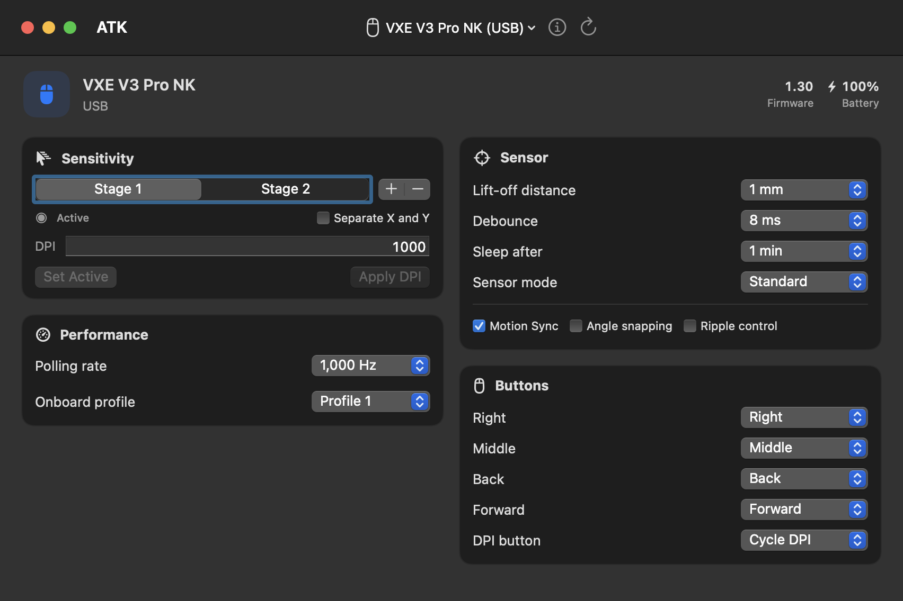

# ATKDriver

ATK is a native macOS app for configuring the VXE V3 Pro NK mouse. It uses SwiftUI for the interface and IOKit to read and write settings over HID.



## Controls

- Set polling rate and switch onboard profiles.
- Add or remove DPI stages, choose the active stage, and set independent X and Y sensitivity.
- Adjust lift-off distance, debounce, sleep, Motion Sync, angle snapping, ripple control, and sensor mode.
- Remap mouse buttons and the DPI button.
- Switch connected mice from the toolbar. Open **Device Details** to see the serial number, hardware IDs, firmware, and battery readouts.

## Build and run

Build with Apple Swift 5.10 or later on macOS 14 or later.

```sh
./build-app.sh
open '.build/ATK.app'
```

Use `swift test` to run the protocol tests. The package also builds `atk-cli` for scripting and diagnostics.

```sh
swift run atk-cli list
swift run atk-cli status
```

## Input Monitoring

The V3 Pro NK shares its configuration interface with keyboard-style reports. If ATK asks for permission, click **Request Input Monitoring** in the app, then enable ATK in **System Settings → Privacy & Security → Input Monitoring**. Choose **Quit & Reopen** if macOS offers it.

The build script uses ad hoc signing by default, so macOS may request approval again after a rebuild. Set `ATK_SIGNING_IDENTITY` to a consistent signing identity if one is available. If another utility such as Karabiner holds the device interface exclusively, release the VXE device there and refresh ATK. [Apple code signing requirements](https://developer.apple.com/documentation/technotes/tn3127-inside-code-signing-requirements/)

## Hardware

The VXE V3 Pro NK (`373b:10e8`, device identity `2:73`, firmware 1.30) was tested over USB. The app detects compatible receivers and Bluetooth mouse interfaces. Configuration over those connections still needs hardware verification.

[Compx report and EEPROM layout](https://github.com/mAbhishek0/vxe-r1se-plus-driver-decomp/blob/main/R1SE_Portable/docs/PROTOCOL.md), [ATK/VXE protocol notes](https://github.com/NasirA1991/atk-control/blob/main/docs/PROTOCOL.md), [Apple IOKit HID](https://developer.apple.com/documentation/iokit/iohiddevice_h_user-space).
